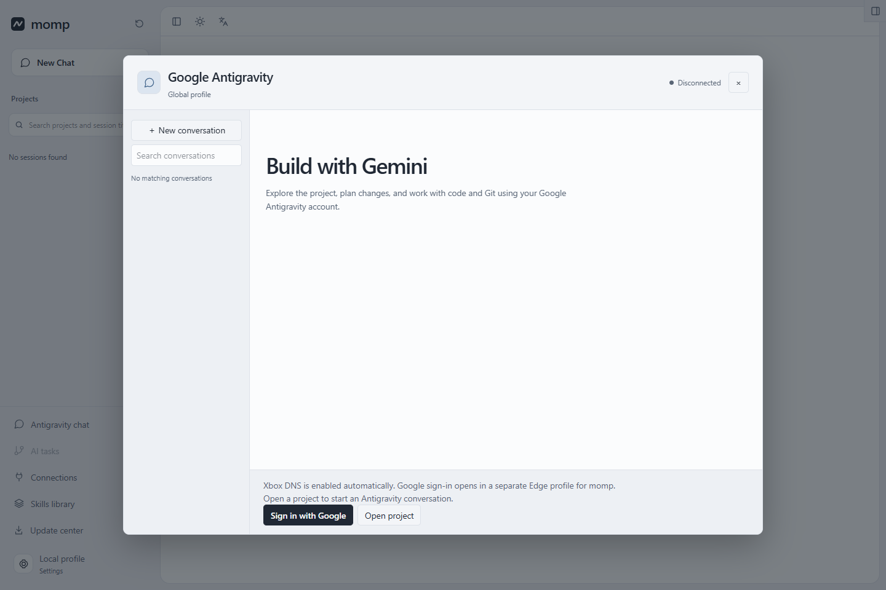
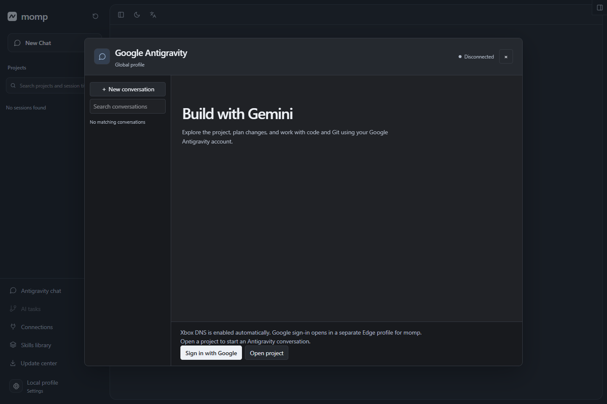
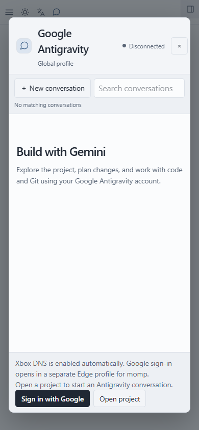
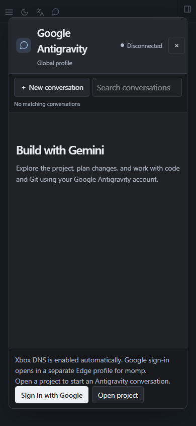

# Xbox DNS interface / Интерфейс Xbox DNS

## English

Captured on November 11, 2026 from the momp 1.6.3-rc.1 production web build using installed Edge and an empty, isolated account profile. The Windows route was enabled by the application's default startup configuration. The check verified the route message, enabled Google sign-in button, viewport fit and absence of page errors at 1440×960 and 390×844 in both themes.

These are real interface screenshots from the final local production rebuild. No Google OAuth request, account login or model task was started. They do not demonstrate successful authorization or inference. See [verification progress](../../IMPLEMENTATION_PROGRESS.md) and the [live checklist](../../en/LIVE_VERIFICATION.md).

## Русский

Снимки сделаны 11 ноября 2026 года в production web-сборке momp 1.6.3-rc.1 через установленный Edge с пустым изолированным профилем. Маршрут Windows включился автоматически при запуске приложения. Проверены сообщение о маршруте, доступность кнопки входа Google, границы окна и отсутствие ошибок страницы при размерах 1440×960 и 390×844 в обеих темах.

Это реальные скриншоты интерфейса из итоговой локальной production-сборки. Запрос OAuth, вход в аккаунт Google и задачи моделей не запускались. Снимки не подтверждают успешную авторизацию или ответы моделей. См. [ход проверок](../../IMPLEMENTATION_PROGRESS.md) и [чек-лист реальных подключений](../../ru/LIVE_VERIFICATION.md).

| View / Экран | Light / Светлая | Dark / Тёмная |
| --- | --- | --- |
| Desktop, 1440×960 / Компьютер |  |  |
| Mobile, 390×844 / Мобильный размер |  |  |

[Candidate release notes / Описание кандидата](../../release-candidate.md) · [Earlier interface gallery / Предыдущая галерея интерфейса](../next/README.md)
